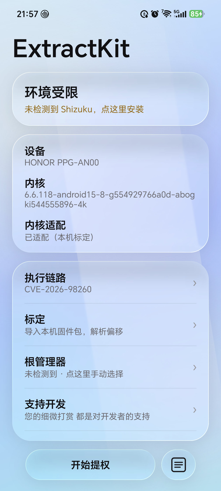

# ExtractKit

**面向荣耀 / MagicOS 的内核 exploit 实验工具**：把 *本机 boot 镜像里的 kallsyms 与结构偏移* 自动算成 payload 需要的常量，然后跑 CVE-2026-98260（POSIX CPU timer UAF → 8 字节零写 → 伪造 cred → `ksud late-load` 装载 KernelSU）。

[](https://github.com/qq2770355800/ExtractKit/actions/workflows/build.yml)

界面用 Jetpack Compose + 真实背景采样的「液态玻璃」实现；所有提权动作在 Shizuku 提供的 shell 上下文里执行（也可在 KernelSU 的 `su` 下运行）。




<sub>左：主页（真实背景采样 + 液态玻璃）。运行日志在同窗口弹出，不再另开 Dialog。</sub>

> 这是一个**研究/自用**项目。它会改内核对象、可能 panic 重启、可能丢失数据；只在**你自己的设备**上跑。

---

## 直接下载 APK

不用自己编译，点这里拿最新的 release 包：

**[→ 最新构建（Actions）](https://github.com/qq2770355800/ExtractKit/actions/workflows/build.yml)**

打开最新一次成功的 run → 页面底部 **Artifacts** → 下载 `ExtractKit-release.zip` → 解压得到 `app-release.apk`。

装之前请确认：Android 12+ / arm64、Shizuku 已授权（或已有 KernelSU 的 `su`）、并在「标定」里导入过本机 boot 镜像（或正好命中内置 profile）。

---

## 它解决什么问题

公开的 98260 exploit 都是「一台机器编一份」，因为下面这些值全在编译期写死：

| 需要的值 | 来源 |
| --- | --- |
| `do_timer_create` / `selinux_state` / `panic_on_warn` / `root_user` / `init_user_ns` / `init_groups` 的绝对地址 | 内核 `kallsyms` 表（需先解 KASLR 前的链接期地址） |
| `kfree`/`kalloc` 调用点（call site） | 反汇编 `do_timer_create` / `prepare_creds` / `copy_process` 里的 `bl kmem_cache_alloc*` |
| `struct cred` / `task_struct` / `k_itimer` 的字段偏移 | 内核内嵌 `.BTF`，没有 BTF 时从 `cred_init` / `fork_init` / `exit_creds` 的常量反推 |
| KASLR slide | 运行时从 `kmem_cache_alloc` 的 trace 记录反推 |

ExtractKit 把这四步全放进手机里做：

```
boot.img / Image  ──►  KallsymsFinder ──►  Btf 解析 / 汇编常量  ──►  device.cfg (336 B)
                                                                    │
                                                                    ▼
                                                          payload（静态 arm64）
```

`device.cfg` 是 336 字节的定长结构（magic `EXKCFG01`），payload 读它就知道该往哪写、写多大。

## 功能

- **标定**：选一个官方 `boot.img` / `Image`，本地解出符号表、BTF 偏移、call site，存成 profile；同内核设备导入后免标定。
- **内置 profile**：仓库里带的 `BUILTIN_PROFILES` 全部来自我们自己解析的官方镜像，每条都注明机型 / 内核 release / 是否真机验证过。
- **识别表**：只有型号没有偏移的内核，用 `Known` 列表给「服务器已收录 / 需标定」的提示，不会冒充可提权。
- **提权**：读模式（只自检）与写模式（fake cred）分开；成功判定只认 `su -c id` 的 `uid=0`，命中日志标记不算。
- **安全模式**：装载前把 `/data/adb/modules/*` 临时 disable，失败/成功都恢复。
- **固件包工具**：`fwbox`（同仓库另一模块）按型号查荣耀官方包直链，只下到 `init_boot` 为止，提取 `boot.img` + `init_boot.img`。

## 支持的机型

见 [`docs/supported-kernels.md`](docs/supported-kernels.md)。核心结论：**按 `g<hash>` 区分，不是按版本号** —— 同一个 `6.1.157-android14-11` 下，不同 build 的 `k_itimer` 尺寸、`task_struct.cred` 偏移、三个 call site 都可能不同。

## 构建

```bash
# JDK 17、Android SDK 35、NDK r29
echo "sdk.dir=/your/android-sdk" > local.properties
./gradlew :app:assembleRelease        # 产出 app/build/outputs/apk/release/
./gradlew :app:testDebugUnitTest      # 79 个单测（解析器 / 偏移 / catalog 一致性）
```

payload 是 C 写的，用 NDK 交叉编译（不依赖 Gradle 的 externalNativeBuild，便于单独出二进制）：

```bash
python tools/build_payload.py         # 产出 payload/ + 同步 PayloadCatalog.kt 与 SHA256SUMS.txt
```

## 目录

```
app/                     Compose UI + 提权编排（ExtractEngine / RunModel / ConfigGen / KallsymsFinder / Btf）
glass/                   本地 vendored 的液态玻璃渲染（io.github.kyant0:backdrop 源码改造）
payload/                 C payload：UAF、fake cred、ksud late-load、pipe 页级 reclaim
app/src/main/assets/payload/   预编译好的 4 支 payload（android / uid0 / fam 5.10 / fam 5.15 / fam 6.1）
docs/                    原理、标定流程、支持列表、排错
```

## 已知限制

- 需要 **tracefs 可写**（Shizuku 的 shell 或 KernelSU 的 `su`）。部分机型 OEM 策略把 `events/*/enable` 全挡掉，此时只能靠分配侧信号，成功率显著下降。
- 一次开机只允许跑一次（`boot_id` 守卫）；成功后进程必须驻留，**清理只能重启**。
- 5.10 一代镜像没有 `.BTF`，偏移靠反汇编 `cred_init` / `fork_init` / `exit_creds` 反推，`init_ucounts` 不存在。
- 本仓库不含任何第三方付费服务的内核档案；没有内置 profile 的内核请用自己的 `boot.img` 标定。

## 许可

MIT，见 [`LICENSE`](LICENSE)。`payload/cve-2026-98260-android` 是公开 PoC 的 Android 移植，来源与授权见 [`docs/credits.md`](docs/credits.md)。

## 致谢

- CVE-2026-98260 的公开分析与其原始 PoC 作者
- KernelSU / SukiSU / MilkSU 等管理器
- [io.github.kyant0:backdrop](https://github.com/Kyant0/AndroidLiquidGlass) 的液态玻璃实现
- Shizuku（提供 shell 上下文）
